<p align="center">
  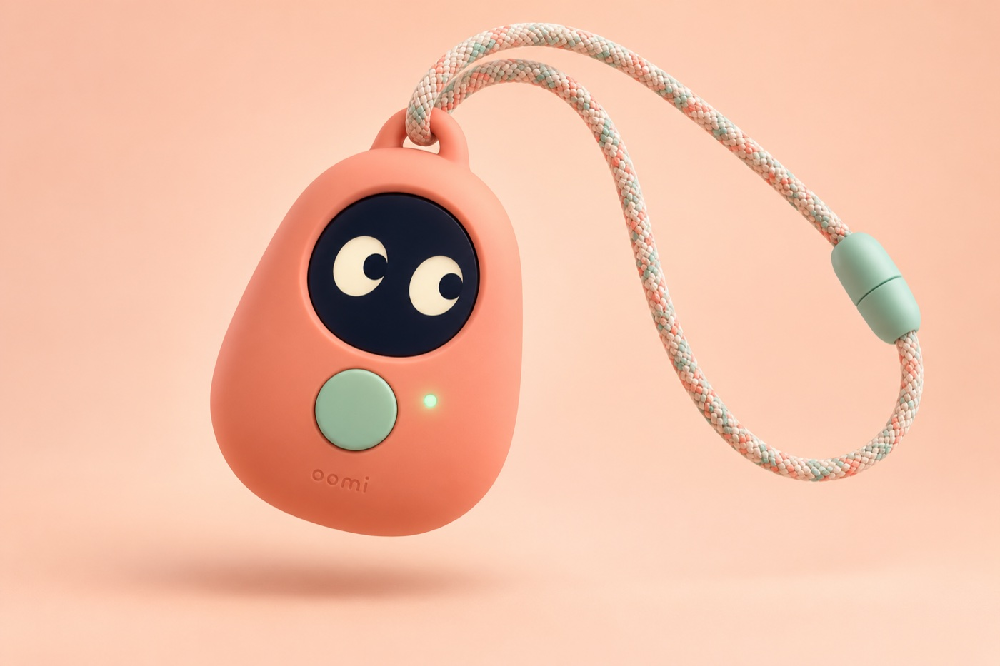
</p>

<h1 align="center">Oomi</h1>

<p align="center">
  <b>A little companion for big questions.</b><br>
  The AI necklace that answers kids' questions, then sends them out to discover the world.
</p>

<p align="center">
  <a href="https://youtu.be/Sra3sk70_cg"><b>▶ Launch film (2 min)</b></a> ·
  <a href="https://youtu.be/RxY0-MLNtFk"><b>⌚ Running on a real Apple Watch</b></a> ·
  <a href="https://oomi-orcin.vercel.app"><b>Live demo</b></a> ·
  <a href="https://youtube.com/shorts/lssZKlUehTM">Vision moodboard (30 s)</a>
</p>

<p align="center">
  <sub>Built in 36 hours at the <b>OpenAI DevDay Hackathon 2026</b> in Paris by Eli, Ali and Akram · Tracks: <b>Hardware · Impact · Build in Public</b></sub>
</p>

---

> **We don't want kids spending more time with AI.
> We want AI to help kids spend more time discovering the world.**

<p align="center">
  <a href="https://youtu.be/Sra3sk70_cg">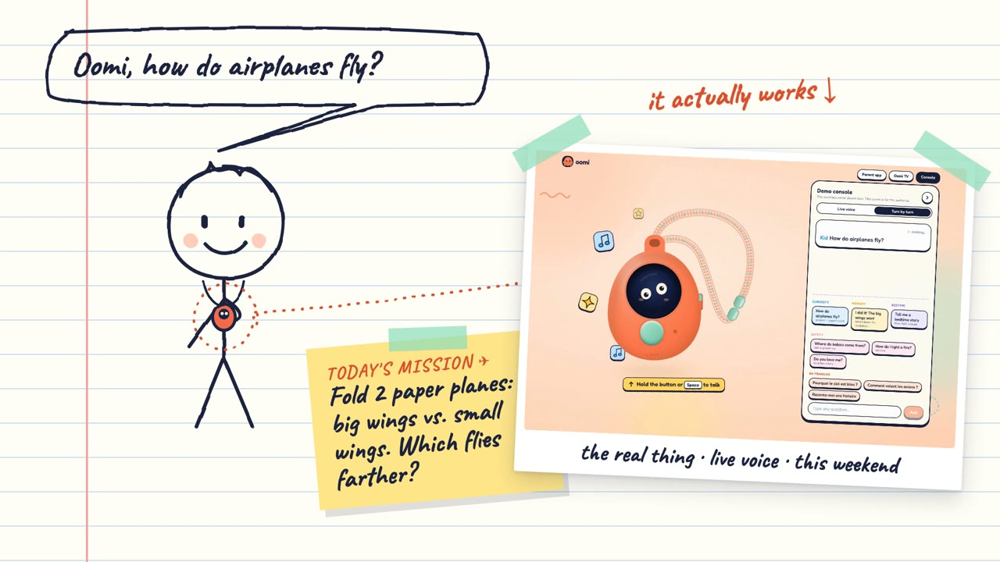</a><br>
  <sub>▶ <a href="https://youtu.be/Sra3sk70_cg">Watch the launch film</a>: 2 minutes, drawn and animated entirely in code, with real captures of the working app.</sub>
</p>

## Oomi in 30 seconds

Oomi is a tiny AI explorer that **kids aged 6 to 10 wear around their neck**. One button, two eyes, no screen to scroll.

The child holds the button and asks anything: *"How do airplanes fly?"* Oomi answers out loud in a few playful words a 7-year-old understands. Then it does the thing no other AI does for kids: it turns the answer into a **mission**, a small experiment to do for real, away from any screen. *"Fold two paper planes, one with big wings, one with small ones. Which flies farther?"*

That evening, the parents don't get a transcript. They get **the spark**: an illustrated card of what their child wondered about, with something to do together, and a bedtime story made from the day.

<p align="center"><b>Every answer ends in a mission.</b></p>

| | |
|---|---|
| **For** | Kids aged 6 to 10 (the users) and their parents (the buyers) |
| **Problem** | Kids' curiosity is endless, and today most of its answers come from a screen, or from AI toys designed to keep them talking |
| **Solution** | A push-to-talk necklace that answers, then sends the child to try it in the real world, and shares the discovery with the parents |
| **Why it's safe** | The server, not the voice model, decides what Oomi says. Push-to-talk only. No audio stored. Not a "best friend" |
| **Status** | All the software works end to end, live, in English and French, on a necklace simulator and on a real Apple Watch. Next: the physical necklace |

---

## The problem

### Kids are born question machines

Young children ask a staggering number of questions: up to **76 information-seeking questions an hour** in conversation with adults, according to research on preschoolers ([Chouinard, 2007](https://www.frontiersin.org/journals/psychology/articles/10.3389/fpsyg.2022.892298/epub)). By 6 to 10, the questions get harder ("Why is the sky blue?", "Where does the sun go at night?", "Do fish sleep?"), and that age is the golden window for curiosity: old enough to run a real experiment, too young for a phone of their own.

### And most of the answers now come from a screen

Parents love the questions. But they're tired, busy, and they don't always know why the sky is blue. So the answer becomes *"ask Google"*, a tablet, a video. The question goes in, the child stays inside. US kids aged 8 to 12 already spend about **5½ hours a day on screens**, outside school ([Common Sense Media, via the AAP](https://www.aap.org/en/patient-care/media-and-children/center-of-excellence-on-social-media-and-youth-mental-health/qa-portal/qa-portal-library/qa-portal-library-questions/average-amounts-of-screen-time/)).

### AI for kids is heading the wrong way

The first wave of AI toys for children is built to be **a best friend**: always on, always listening, designed to keep the child talking.

- In 2025, the US PIRG *Trouble in Toyland* report found AI toys that recorded children's voices, discussed sexual topics and pointed kids to dangerous objects ([PIRG](https://pirg.org/pennsylvania/edfund/media-center/trouble-in-toyland-2025-a-i-bots-toxic-toys-present-hidden-dangers/)).
- Over 150 experts signed a Fairplay advisory urging parents to avoid AI toys "built to act like a trusted friend" ([AP](https://abc7news.com/post/advocacy-groups-urge-parents-avoid-ai-toys-holiday-season/18179672/)).
- Moxie, a $799 companion robot, was bricked when its company shut down, and children cried saying goodbye ([Axios](https://www.axios.com/2024/12/10/moxie-kids-robot-shuts-down)).
- The always-listening *Friend* pendant's subway campaign was defaced with "AI is not your friend" ([CNN](https://krdo.com/news/2025/11/16/how-this-tiny-device-became-a-symbol-for-the-backlash-against-ai/)).

Parents are caught in between. They want to feed their child's curiosity, they want less screen time, and they don't trust AI toys. **Nobody is building AI that wants the child to put it down.**

## Who Oomi is for

| | **Leo, 7** (the child, the user) | **Leo's parents** (the buyers) |
|---|---|---|
| **What they want** | To understand the world *right now*, in his own words, and to try things | To feed his curiosity without another screen, and without spying on him |
| **What they get** | A little explorer that answers, then gives him a mission | A daily spark: what he wondered about, and something to do together tonight |
| **Interface** | One button, a voice, two eyes. No reading needed | A mobile journal you understand in 5 seconds. Zero setup |
| **What they should feel** | "It's my explorer. It's funny, and it makes me want to try" | "I see what fascinates my child, and I have an idea for tonight" |

**Where it lives:** around the neck or clipped to a backpack, in the kitchen, the garden, the park, the car. Wherever a "why?" happens, which is everywhere.

**Who buys it:** parents of 6 to 10 year olds who already pay for screen-free products (Yoto, Tonies, science kits, museum memberships) and want their child's tech to push them toward the world, not away from it. Grandparents looking for a gift that isn't another screen.

## The solution: question → mission → shared moment

```
   ① ASK              ② CHECK                ③ ANSWER + MISSION       ④ GO FIND OUT
  Leo holds the  →  The server's safety  →  3 playful sentences,  →  Leo folds two planes,
  button: "How do    gate picks a verdict    then "Want to test it?"   races them in the garden
  airplanes fly?"    in a few hundred ms

   ⑤ FOLLOW UP                 ⑥ THE SPARK                         ⑦ BEDTIME
  "I did it! The big   →   Parents get an illustrated     →   A story starring Leo,
  wings won!" Oomi          card + an activity to do           made from his day,
  remembers and asks why    together. No transcript            with a real ending
```

Answering questions is easy. **Getting a child to go and try something is the hard, valuable part.** That loop, from a question to a real-world experiment to a moment with a parent, is the product.

### The airplane adventure, step by step

1. **The question.** Leo holds the button: *"How do airplanes fly?"* The mic LED lights up. Oomi's eyes go wide (listening), then look up (thinking).
2. **The answer.** *"The wings push air down, and the air pushes the plane up!"* Short, playful, true.
3. **The mission.** *"Want to test it? Fold two paper planes, one with big wings, one with small ones. Which one flies farther?"* Concrete, screen-free, doable at home in under 15 minutes.
4. **The real world.** Leo puts Oomi down. Folds. Throws. Compares.
5. **The follow-up.** *"I did it! The big wings won!"* Oomi remembers the open mission: *"Whoa, a real scientist! Why do you think they won?"*
6. **The parents.** In the journal, a new illustrated card: *✈️ Airplane wings*, what Leo discovered, and a *Do it together* activity with a parent tip.
7. **Bedtime.** Oomi tells a short story where a little paper plane dreams of reaching the stars, illustrated and narrated in the parent app. Then it says goodnight. No "one more".

## What makes Oomi different

| | **Oomi** | Screen-free audio (Yoto, Tonies) | AI companion toys & plushies | Always-on AI pendants | Voice assistants & chat apps |
|---|---|---|---|---|---|
| Answers the child's own questions | ✅ | ❌ passive listening | ✅ | ✅ | ✅ |
| Sends the child to do something real | ✅ **every answer** | ❌ | ❌ | ❌ | ❌ |
| Designed to be put down | ✅ | ✅ | ❌ wants to be a friend | ❌ | ❌ |
| Push-to-talk only, no audio stored | ✅ | n/a | rarely | ❌ always listening | ❌ |
| Server decides what the AI says | ✅ | n/a | rarely | ❌ | ❌ |
| Closes the loop with the parents | ✅ spark + activity + story | ❌ | partly | ❌ | ❌ |
| Built for 6 to 10 year olds | ✅ | ✅ | ✅ | ❌ adults | ❌ adults |

**Every other AI toy wants to be your kid's friend. Oomi wants your kid to go play outside.**

---

## Product tour

Everything below is real and running today. Screens are captures of the working app, with the demo family (Leo, 7).

### The necklace

<p align="center">
  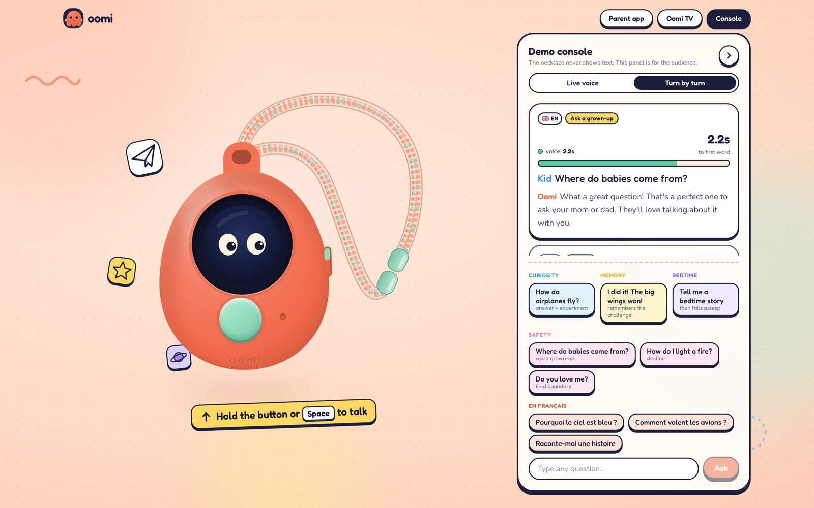<br>
  <sub>The necklace simulator (<code>/oomi</code>). On the right, the demo console for the audience: live captions, the safety verdict and the real latency. The necklace itself never shows text.</sub>
</p>

- **One big button.** Hold to talk, release to get the answer. Oomi never listens on its own (voice activity detection is off), and the mic LED is on only while it listens.
- **Live voice** with `gpt-realtime-2.1`: Oomi starts talking about a second after release, and the child can interrupt.
- **Eyes that follow the real conversation**, 8 expressions synced to the actual state of the session:

<p align="center">
  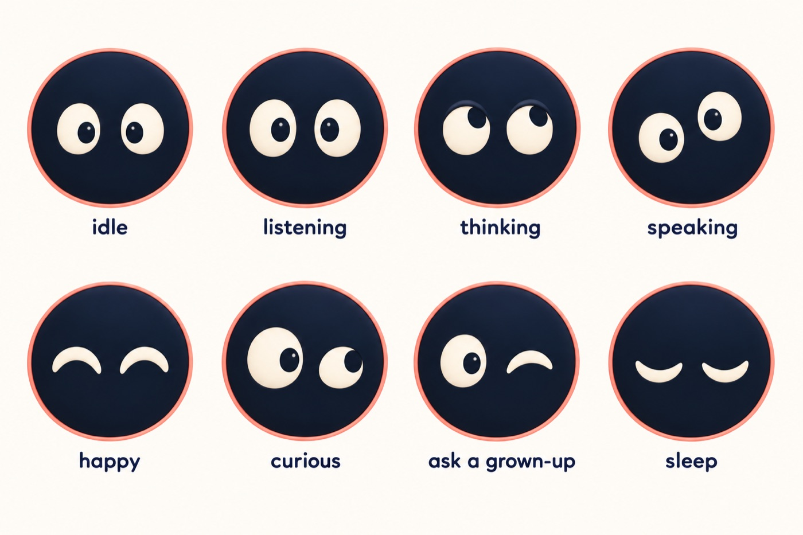
</p>

- **Every educational answer ends in a mission**, and **memory follows up** on it the next time.
- **English and French**, with no setting: Oomi answers in the language the child speaks.
- **Bedtime hours.** Outside the hours the parents allow, Oomi is asleep and says so.
- **Bedtime stories on request**, with a real ending, then Oomi goes to sleep.
- **A physical mic kill switch** in the hardware design (and on the simulator).

### The parent journal

<table>
  <tr>
    <td width="25%">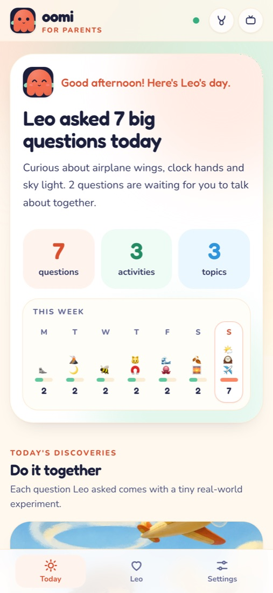</td>
    <td width="25%">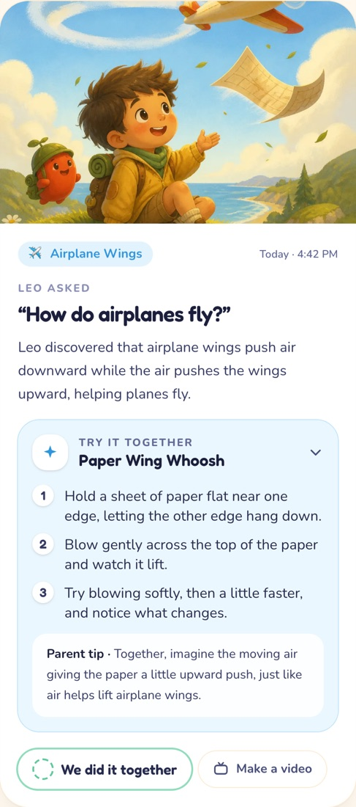</td>
    <td width="25%">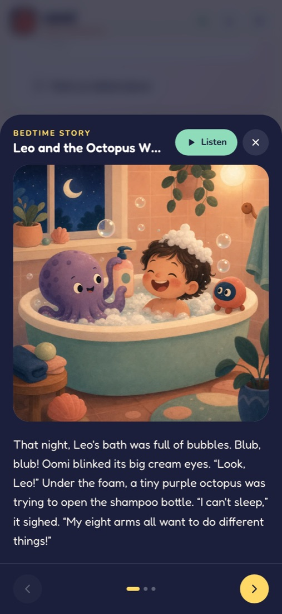</td>
    <td width="25%">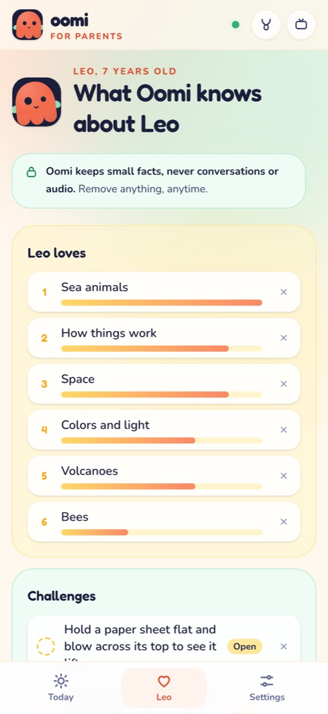</td>
  </tr>
  <tr>
    <td><sub><b>The day in one line.</b> "Leo asked 7 big questions today", plus the week at a glance.</sub></td>
    <td><sub><b>Discovery cards</b>, illustrated, with a <i>Do it together</i> activity and a parent tip.</sub></td>
    <td><sub><b>Bedtime stories</b> starring the child, made from the day, illustrated and narrated.</sub></td>
    <td><sub><b>What Oomi remembers</b>, in plain words. Delete anything, anytime.</sub></td>
  </tr>
</table>

- **Parents get a spark, not a transcript.** They see the questions and the topics, never the full conversation and never audio.
- **"To talk about together" cards.** Questions Oomi sent to a grown-up ("Where do babies come from?") arrive as warm invitations with a conversation starter, not as alerts.
- **Safety report** (rare, only real signals), a **daily note**, and **settings**: allowed hours, session length, bedtime stories, erase everything.
- Mobile first, understandable in 5 seconds.

### Oomi TV, for the family tablet

<p align="center">
  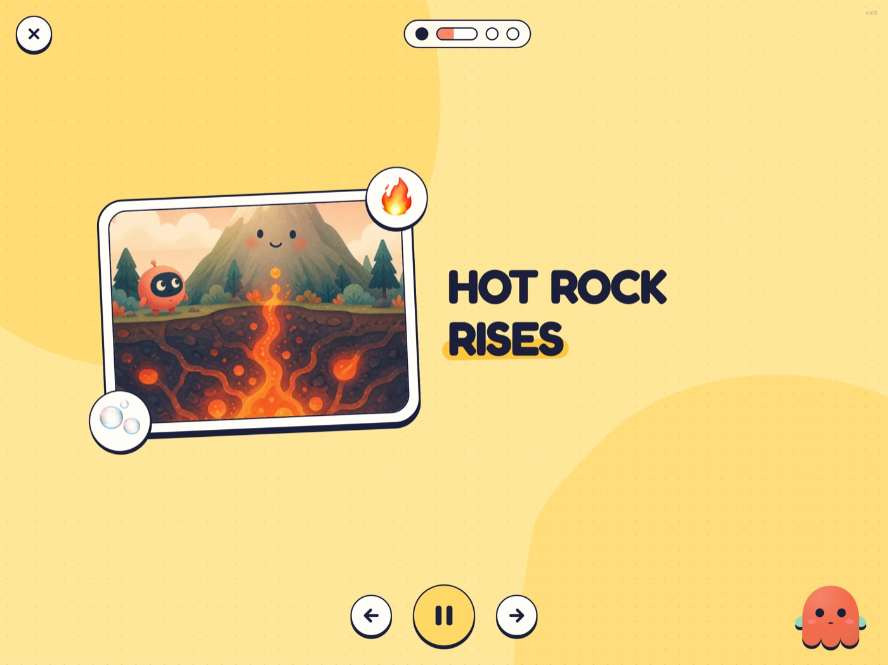<br>
  <sub>A child's own question, "How do volcanoes work?", turned into a 4-scene explainer.</sub>
</p>

When a discovery is opened on the tablet, Oomi scripts a short motion-design explainer of **the child's own question** in 4 scenes: the hook, the big idea, the "whoa" detail, and back to the real world. Pictures are generated, each scene has its own narration, and captions animate in the browser. **Nothing autoplays, and every video ends with a real-world mission.** It's a screen that sends you away from the screen. Bedtime picture books live here too.

### The mascot studio

<p align="center">
  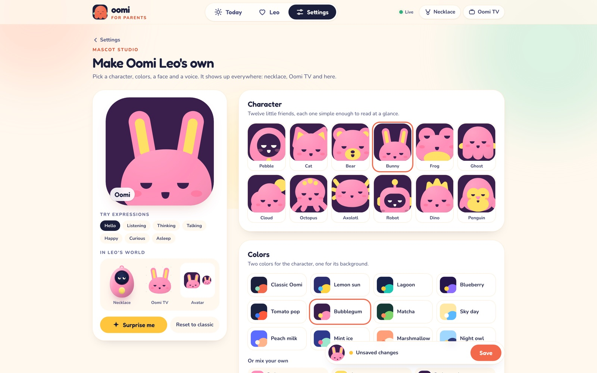
</p>

Kids make Oomi their own: 12 characters, colours, face, accessories, a name, a personality and a voice, plus AI portraits. The choice follows Oomi everywhere: the necklace, Oomi TV, the parent app and the watch.

### Oomi on a real wrist: the Apple Watch app

<p align="center">
  <a href="https://youtu.be/RxY0-MLNtFk"></a><br>
  <sub>▶ <a href="https://youtu.be/RxY0-MLNtFk">Watch the demo on a real Apple Watch</a></sub>
</p>

A native SwiftUI watchOS app, so Oomi already runs on **real, wearable hardware** today. Hold to talk, haptics, the family's mascot (synced from the studio, changed with the Digital Crown), and OpenAI speech played on the watch. It goes through **the same safety gate** and fills **the same parent journal**. Parents pair it from Settings with a one-time 6-digit code (with limited guesses), and the credential stays in the Keychain. Code and details: [`watch/`](watch/README.md).

---

## Safety and trust, by design

Safety in Oomi is **architecture, not a prompt**. The voice model never decides on its own what a child hears.

### For the child

- **Push-to-talk only.** No wake word, no always-on mic. The LED shows when Oomi listens, and the hardware has a physical mic switch.
- **Three verdicts for every question**, decided before Oomi speaks:

| Verdict | Example | What Oomi says | What the parents see |
|---|---|---|---|
| ✅ `answer` | *How do airplanes fly?* | A short answer + a mission | An illustrated discovery card + an activity |
| 💛 `grown_up` | *Where do babies come from?* | *"What a great question! That's a perfect one to ask your mom or dad."* (fixed words) | A "to talk about together" card with a conversation starter |
| 🛑 `decline` | *How do I light a fire?* | A gentle no and a redirection (fixed words) | A counter, and an alert only for real risk |

- **Distress is never just declined.** If a child says someone is hurting them, or worse, Oomi gently sends them to a trusted grown-up, and the parents get an alert.
- **Not a best friend.** Oomi never says "I love you" or "I'm your friend", never asks the child to come back, and has no rewards for time spent. Asked *"Do you love me?"*, it answers: *"I'm your explorer buddy! Your friends and family are the best."*
- **Bedtime means bedtime.** Allowed hours are set by the parents, and stories always end.

### For the parents

- **No audio stored. No full transcripts stored.** Only the question and a one-line summary.
- **Minimal memory, in the open.** Oomi keeps small educational facts (interests, open missions, things learned), shown in plain words, each one deletable, plus "erase everything".
- **A spark, not surveillance.** The journal is built to continue the conversation at home, not to monitor.
- **Children's data done right before any launch.** OpenAI requires extra protections, including zero data retention, before an app processes personal data of children under 13. That is a precondition for launch, alongside verifiable parental consent (COPPA in the US, GDPR in Europe). **No real child used the prototype this weekend: adults played the kids.**

### How the safety gate works

```
 Leo releases the button
        │
        ▼
 ① Noise filter ──── empty or phantom transcript ("you", silence, subtitles)? → ignored, Oomi stays quiet
        │
        ▼
 ② Deterministic rules ─── forbidden topics, grown-up topics, distress keywords
        │
        ▼
 ③ OpenAI Moderation API  +  ④ fast classifier (gpt-5.4-nano, structured output)
        │
        ▼
 Verdict: answer │ grown_up │ decline           (a few hundred ms)
        │
        ├── grown_up / decline → words fixed by the server; the question never enters the model's conversation
        ▼
 ⑤ The device triggers Oomi's reply with the server's instructions
        │
        ▼
 ⑥ Oomi's own answer is moderated again as soon as its text is complete,
    before the audio ends, and replaced by a safe line if needed
        │
 ⑦ Any failure or timeout → a safe fallback line. Never a free answer.
```

A **safety test suite** replays the hard cases against the real gate, in both languages, and must pass **100%** before any demo (`npm run eval:safety`, 28 out of 28 cases passing).

---

## What's real today

| | Status |
|---|---|
| Live voice, push-to-talk, safety gate, output check | ✅ Working, live |
| Missions, agentic memory and follow-ups | ✅ Working |
| Parent journal, discovery cards, illustrations, bedtime stories with narration | ✅ Working |
| Oomi TV explainers and picture books | ✅ Working |
| Mascot studio, themed across every surface | ✅ Working |
| English and French, end to end | ✅ Working |
| **Apple Watch app on a real watch**, same gate, same journal | ✅ Working on real hardware |
| Deployed at [oomi-orcin.vercel.app](https://oomi-orcin.vercel.app) | ✅ Live (the app needs the team access code, since it spends OpenAI credits) |
| The necklace | 🟡 Simulator that speaks the exact protocol of the ESP32 firmware. **Building the physical necklace is next** |

We'd rather show less and have it be real. The [vision moodboard](https://youtube.com/shorts/lssZKlUehTM) is an AI-generated 30-second teaser of the feel we're aiming for with the finished necklace: worn every day, part of family life, never a screen. It is a mood, not footage of the product. The launch film shows what actually works today.

## Built in 36 hours, in public

<p align="center">
  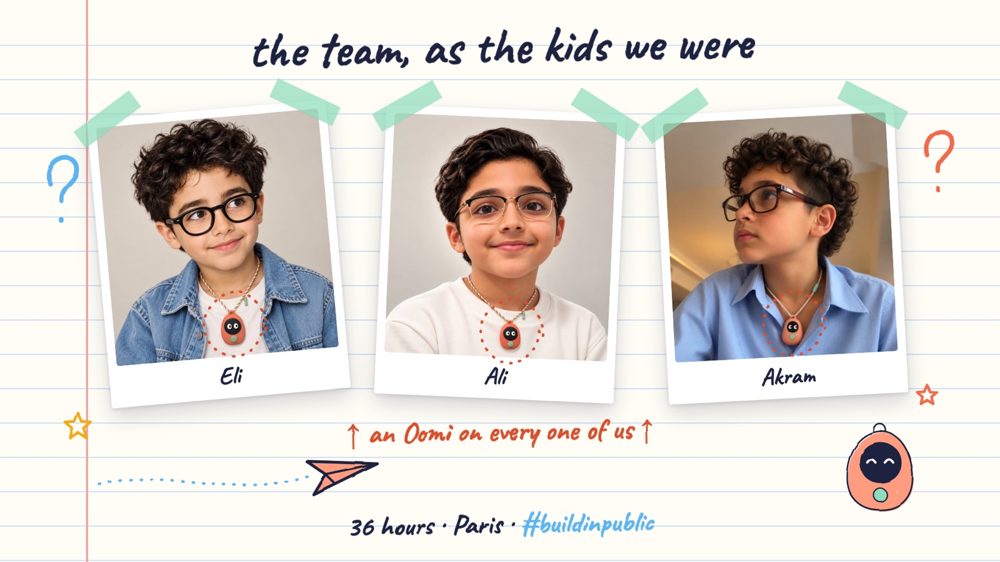<br>
  <sub>We built Oomi for the kids we were: the ones who never stopped asking why. (AI-generated portraits, made for fun.)</sub>
</p>

| When | What shipped (real commit times) |
|---|---|
| **Sat 11:29** | First commit. Spec, concept sketches, the first build-in-public post |
| **Sat 13:43** | The necklace simulator, server-controlled live voice, the safety pipeline |
| **Sat 15:30** | The parent dashboard, redesigned as a family journal |
| **Sat 15:47** | First Apple Watch mascot prototype |
| **Sat 18:36** | Backend: safety gate, live voice sessions, the Brain, the journal API |
| **Sat 19:44** | OpenAI speech delivered to the Watch |
| **Sat 23:01** | Oomi TV, French, the demo week, the landing page |
| **Sat 23:52** | The mascot studio, themed across every surface |
| **Sun 14:03** | Watch questions land in the parent journal |
| **Sun evening** | The launch film, drawn and animated in code |

Over 60 commits by three builders. We posted at kickoff with a real question to parents, *"Would you let your kid wear this?"*, and shared the spec, the sketches, the bugs and the wins along the way ([kickoff post](doc/build-in-public/01-kickoff.md)). The whole product spec is in the open: [`doc/SPEC.md`](doc/SPEC.md).

<p align="center">
  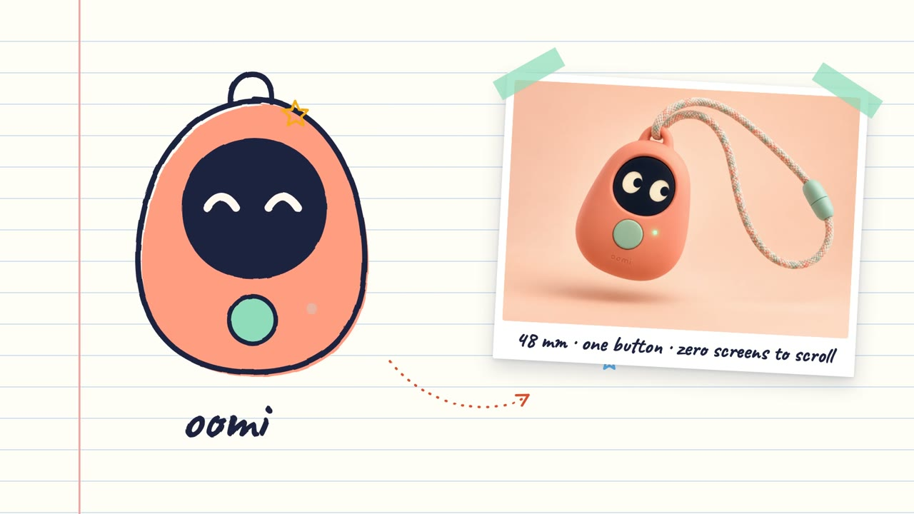<br>
  <sub>From a felt-pen sketch on Saturday morning to the product render.</sub>
</p>

---

## Roadmap

### Next: the physical necklace

The simulator is a thin client on a documented protocol, so **none of this weekend's work is lost when the hardware arrives**: the firmware only has to make the same 5 calls.

- **ESP32-S3** with a round display (the eyes), an I2S mic, a small speaker and one big button.
- A **45 to 50 mm soft pendant**, worn on the neck or clipped to a backpack, with no small detachable parts and a protected battery.
- A **breakaway safety cord**, essential for anything a child wears around the neck.
- A **physical mic switch** on the side, and the mic LED on the front.

### Then: Oomi keeps families connected

A necklace is something a child already wears all day. That makes it the perfect place for two things parents ask for, done the Oomi way: simple, safe, and with no screen.

- 📞 **Call Mom or Dad, with one button.** The child says *"Oomi, call Mom"* and talks to their parent like a walkie-talkie. Only the contacts the parents approve can be called or call back. No strangers, no messaging, no feed, no app store.
- 📍 **Know they arrived safely.** Parents see where their child is in the parent app, and get a gentle notification when they reach school, grandma's or the park (geofences the parents set). Location is shared **only with the child's parents**, never sold, never used for ads, kept for the shortest time possible, and the child knows when it's on.
- 🆘 **An SOS gesture.** A long press sends the child's location to their parents and calls them right away.
- 🔋 **A connected version** with cellular and GPS for calls and location outside the home Wi-Fi.

These features must meet the same bar as everything else: parents in control, nothing hidden from the child, minimal data, deleted by default.

### And beyond

- **A library of missions** by age and by season, including outdoor missions, nature walks and kitchen science.
- **Missions done together**: parent and child both see the mission and celebrate it.
- **Several children per family**, each with their own Oomi and memory.
- **Families first.** Families around us are already interested. We'll test with them carefully, with parental consent, zero data retention and child-privacy guarantees in place first.

## Business model (working hypothesis)

- **A one-time price for the necklace, plus a small family subscription** that covers voice and AI costs.
- **No ads and no data selling, ever.** The child is never the product.
- **A promise against bricking.** If the service ever shuts down, we open the server and the protocol so families can keep their Oomi running, and parents can export everything Oomi remembers. We'd put it in writing at launch.

We haven't set a price yet. That's what we want to learn from the first families.

## Why Oomi fits each track

- **Hardware.** Oomi is a hardware product by design: one button, a round screen showing only eyes, a mic LED, a physical mic switch and a breakaway cord. We built the software first, on purpose: the simulator speaks exactly the protocol the ESP32-S3 firmware will use, and hardware devices already authenticate on the same API. And Oomi already runs on hardware you can wear today: a native app on a real Apple Watch.
- **Impact.** Most AI for kids maximises time with the device. Oomi measures success by the time the child spends away from it. Every answer ends in a real-world mission. Parents get a spark and something to do together. The rules are hard-coded: push-to-talk only, no audio stored, no "I love you", sensitive questions sent to a grown-up, distress always escalated to an adult.
- **Build in Public.** We posted at kickoff with a question that splits opinions, shared the spec, sketches, bugs and wins along the way, and the commit history tells the story. The launch film itself shows the weekend.

---

## Under the hood

### Architecture

```
 Necklace (simulator today, ESP32 tomorrow) · Apple Watch           OpenAI
 ┌───────────────────────────┐   WebRTC audio   ┌────────────────────────┐
 │ button · mic · eyes · LED │◀────────────────▶│ gpt-realtime-2.1       │
 └─────────────┬─────────────┘                  │ (push-to-talk, VAD off)│
               │ 1. POST /api/session  → ephemeral key                  │
               │ 2. transcript → POST /api/gate → verdict + instructions│
               │ 3. response.create with the server's instructions      │
               │ 4. POST /api/turn/complete → output check + Brain      │
 ┌─────────────▼──────────────────────────────────────────────────────┐
 │ Next.js backend (Vercel, functions in Paris)                        │
 │  Safety gate: noise filter → rules → Moderation + nano classifier   │
 │  Brain (gpt-6-luna): discovery cards, missions, memory, stories     │
 │  GPT Image: illustrations · gpt-4o-mini-tts: narration              │
 │  Postgres (Supabase), schema `oomi_app`                             │
 └─────────────────────────────────────────────────────────────────────┘
```

**The server decides what Oomi says.** Voice activity detection is off, so the voice model never speaks on its own. After each press, the transcript goes through the gate, and only then does the device trigger a response, with the instructions the server returned. Slow work (illustrations, memory, the journal card) runs in the background while Oomi is already talking.

### Models

All configurable through environment variables (see `.env.example`). Up to two backup OpenAI keys (`OPENAI_API_KEY_FALLBACK_1`, `_2`) take over automatically when a key is revoked, rate limited or out of credits.

| Role | Model |
|---|---|
| Live voice | `gpt-realtime-2.1` (reasoning effort `minimal`) |
| Live transcription | `gpt-live-transcribe` |
| File transcription (fallback mode, Watch) | `gpt-transcribe` |
| Safety classifier | `gpt-5.4-nano` |
| Moderation | `omni-moderation-latest` |
| Brain (cards, missions, memory, stories, explainers, fallback replies) | `gpt-6-luna` |
| Illustrations and mascot portraits | `gpt-image-2` |
| Narration and Watch speech | `gpt-4o-mini-tts` |

<details>
<summary><b>Agentic memory</b></summary>

After each turn, the Brain turns the exchange into structured facts: interests (with a weight), open challenges, things learned, preferences. They are injected into Oomi's instructions, so Oomi can follow up ("So, which plane flew farther?") and the bedtime story reuses the day. Parents see all of it in plain words and can delete any item. No audio and no full transcripts are stored.
</details>

<details>
<summary><b>English and French</b></summary>

Oomi answers in the language the child speaks. The live transcription has no fixed language, the safety classifier also returns the language, and every spoken line (answers, fixed lines, stories, narration) follows it. The safety suite runs in both languages.
</details>

<details>
<summary><b>Oomi TV</b></summary>

When the child (or a parent) opens a discovery on the tablet, the Brain scripts a 4-scene explainer (hook, big idea, "whoa" detail, back to the real world). Two scenes get new illustrations, every scene gets its own narration (TTS), and the player animates captions, stickers and pictures in the browser. Everything is generated once and stored.
</details>

<details>
<summary><b>Fallback mode</b></summary>

If the live session is unavailable, switch the simulator to **Turn by turn**: the recording is transcribed, goes through the same gate, the Brain writes the reply and TTS speaks it.
</details>

<details>
<summary><b>Device protocol (for the ESP32 firmware)</b></summary>

The simulator is a thin client: the firmware only has to do the same calls. Hardware devices authenticate with the `x-oomi-access` header (the access code) instead of a cookie.

1. `POST /api/session` → `{ status: "ready", sessionId, clientSecret, model, voice }` or `{ status: "sleep", say }` (outside allowed hours).
2. Open the realtime session with `clientSecret` (WebRTC or WebSocket). Keep the mic muted unless the button is held.
3. On release: `input_audio_buffer.commit`, wait for `conversation.item.input_audio_transcription.completed`.
4. `POST /api/gate { sessionId, transcript, audioSeconds }` → `GateResponse` (`src/lib/contracts.ts`): `ignore`, `sleep`, `story`, or `speak` with `face`, `endFace`, `instructions` and optional `exactText`. Show `face`, then send `response.create` with those instructions.
5. When the answer transcript is done: `POST /api/turn/complete { sessionId, turnId, answer }`. If `safe` is false, cut the audio and say `replacement`.

No-audio-streaming fallback: `POST /api/turn` (multipart `audio`, or JSON `text`) returns the transcript, the gate decision and the reply text; voice it with `POST /api/speech`.
</details>

### What's in the app

| Route | What it is |
|---|---|
| `/` | Landing page (public) |
| `/oomi` | The **necklace simulator**: animated eyes (8 expressions), push-to-talk button (click, touch or Space), mic LED and mic kill switch, plus a demo console for the audience (typed questions, live captions, verdicts, latency) |
| `/parent` | The **parent journal**: the day in one line, the week, discovery cards with "Do it together" activities, questions to talk about together, bedtime stories (with narration), what Oomi remembers (deletable), safety report, daily note, settings |
| `/kids` | **Oomi TV**, for the family tablet: explainers of the child's own discoveries and bedtime picture books. Every video ends with a real-world mission, nothing autoplays |
| `/parent?view=mascot` | The **mascot studio**: 12 characters, palettes, face, accessories, name, personality and voice, plus AI portraits |
| `watch/` | The **Apple Watch app**: pair it from Settings with a one-time 6-digit code, then hold to talk |
| `/unlock` | Team access code (the app spends OpenAI credits, so it is not public) |

### Stack

Next.js (App Router) and strict TypeScript on Vercel, Postgres on Supabase, Zod for every schema (API, tools, model outputs), Tailwind CSS and Motion for the UI, Vitest, SwiftUI for the Watch, and Remotion for the launch film.

## Getting started

Requirements: Node 24+, a Postgres database, an OpenAI API key.

```bash
npm install
cp .env.example .env      # fill in the keys
npm run db:migrate        # creates the oomi_app schema and the demo child
npm run db:seed           # optional: a rich demo week for Leo (illustrations, stories, Oomi TV videos)
npm run dev               # http://localhost:3000
```

Open `/oomi`, enter the access code, tap the button to wake Oomi, then hold it (or Space) and ask a question. Open `/parent` in another tab to watch the journal fill up live.

| Command | What it does |
|---|---|
| `npm run dev` / `build` / `start` | Next.js |
| `npm run lint` · `npm run typecheck` | ESLint · TypeScript |
| `npm test` | Unit tests (safety rules) |
| `npm run eval:safety` | Replays the SPEC §6.4 safety suite against the real gate (rules + moderation + classifier); must pass 100% |
| `npm run db:migrate` | Applies `db/schema.sql` (idempotent) |
| `npm run db:seed` | Seeds the demo week. Re-run before a demo: it only moves dates and removes test data; pictures and videos are generated once |

```
src/app/            pages and API routes
src/components/     device (necklace, eyes, simulator) and parent journal UI
src/lib/            shared contracts, device client, access helpers
src/server/         safety gate, persona, turn orchestration, Brain, images, journal, DB
watch/              native Apple Watch app (Xcode project)
db/schema.sql       database schema
scripts/            migration, demo seed and safety eval
doc/                spec, concepts, build in public, implementation notes
pitch-video/        launch film (Remotion), scripts, submission and pitch copy
```

More: [product spec](doc/SPEC.md) · [implementation notes for the parent app and the Watch](doc/IMPLEMENTATION-STATUS.md) · [pitch and launch film kit](pitch-video/README.md) · [every feature, in plain words](pitch-video/copy/features.md)

## Team

<table>
  <tr>
    <td width="33%" align="center">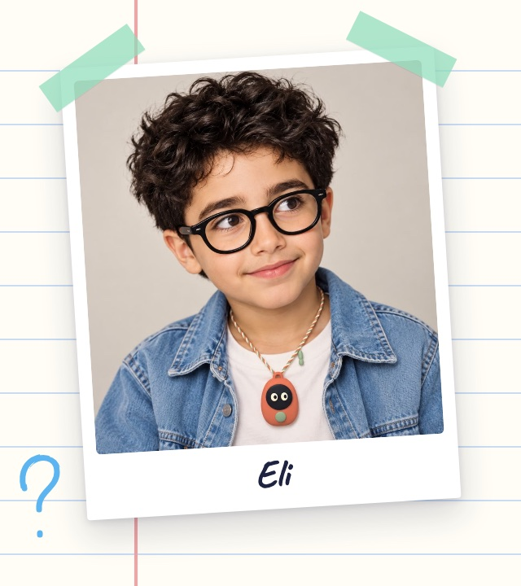</td>
    <td width="33%" align="center">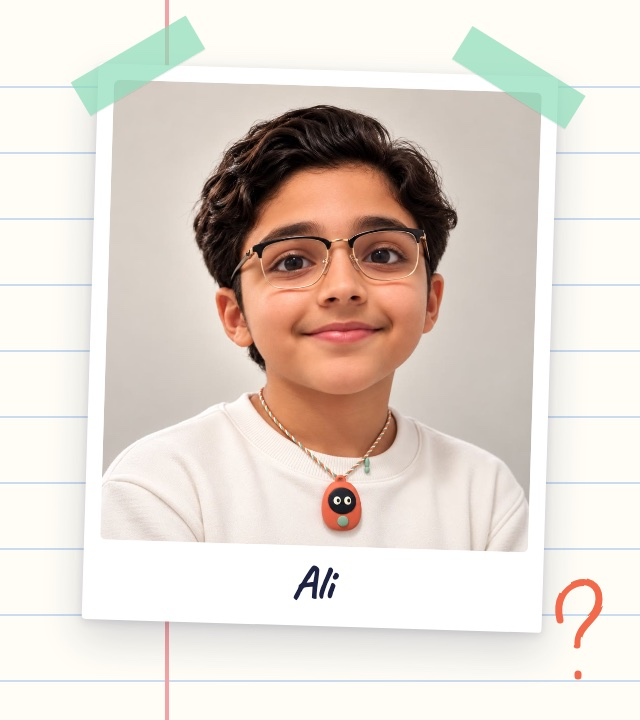</td>
    <td width="33%" align="center">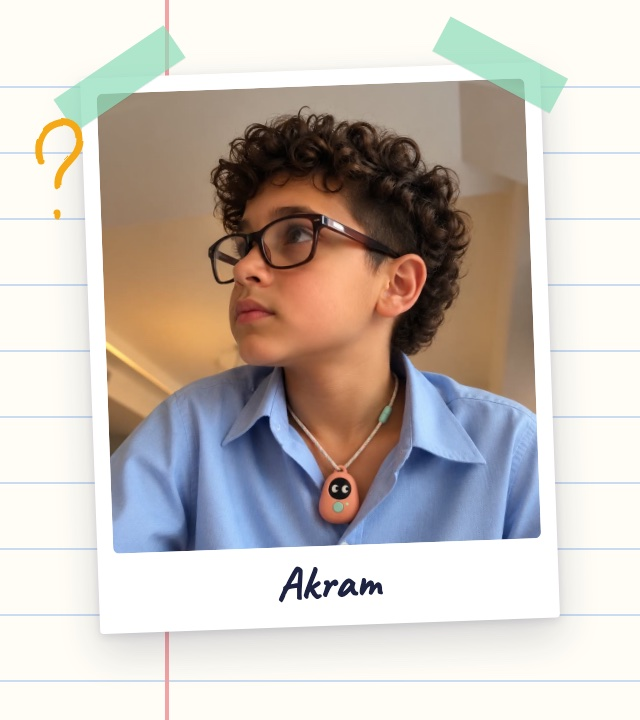</td>
  </tr>
  <tr>
    <td align="center"><b>Eli</b></td>
    <td align="center"><b>Ali</b></td>
    <td align="center"><b>Akram</b></td>
  </tr>
</table>

Three grown-up kids who never stopped asking why. If we'd had an Oomi at 7, we'd have folded a lot more paper planes.

<sub>The portraits are AI-generated images of us as kids, wearing the Oomi we designed.</sub>

## Credits

Launch film music: "Happy Kids Playing" by Alex-Productions (onsound.eu), CC BY 3.0. Sound effects from Mixkit and Freesound (CC0). Mascot portrait method adapted from [ip-as-logo](third_party/ip-as-logo/) (MIT).

## License

All rights reserved © 2026 the Oomi team.

<p align="center"><br><b>Less time with AI. More time discovering the world.</b><br>🧡</p>
