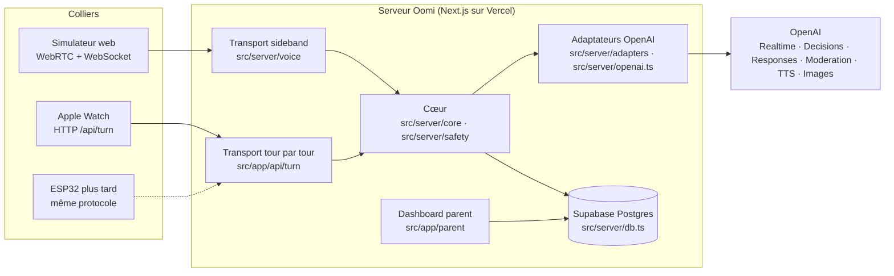

# Architecture Oomi

Référence pour toute l'équipe. Tout ce qui est construit (simulateur web, Apple Watch, dashboard parent, futur ESP32) converge vers cette structure. Mise à jour : samedi 24 octobre 2026.

## Principe

**Un seul cerveau, plusieurs colliers.** Le cœur (sécurité, verdict, génération, mémoire) vit côté serveur dans un module sans dépendance au transport. Chaque appareil s'y branche par un transport adapté à ses capacités : WebRTC live pour le navigateur, HTTP tour par tour pour la montre. Le navigateur comme la montre n'envoient que de l'audio et quelques événements typés ; **ils ne parlent jamais directement à OpenAI avec une clé**.

## Couches et dossiers

| Dossier | Contenu | Règle |
|---|---|---|
| `src/lib/` | Contrats Zod partagés : `contracts.ts` (états du visage, verdicts, événements client/serveur, `Discovery`), `journal.ts` (enfant, réglages, cartes, mémoire, histoires), `turn.ts` (requête/réponse tour par tour) | Aucune logique. Tout ce qui traverse une frontière (réseau, base, Swift) a son schéma ici |
| `src/server/core/` | `turn.ts` : un tour complet, du texte ou de l'audio jusqu'à l'audio approuvé | Pas d'import OpenAI, pas de base, pas de transport. Testé avec des stubs |
| `src/server/safety/` | `policy.ts` (filtre d'entrée, règles, phrases fixes, `screenInput` / `screenOutput`), `cases.ts` (les 11 cas) | Le verdict le plus strict l'emporte toujours. Les refus ne sont jamais générés |
| `src/server/adapters/` | `openai-turn.ts` : transcription de fichier, génération Responses, synthèse TTS | Un adaptateur par service externe. Les identifiants de modèles viennent de l'environnement |
| `src/server/openai.ts` | Modération, verdict Decisions, contrôle de sortie, config de session Realtime | Historique : à déplacer dans `adapters/` au nettoyage |
| `src/server/voice/` | `connection.ts` (appel Realtime + sideband), `controller.ts` (machine à états du tour live) | Transport live du simulateur. À déplacer dans `transports/` au nettoyage |
| `src/server/db.ts` · `db/migrations/` | Pool pg, sessions, audits ; schéma SQL numéroté | Jamais d'audio ni de transcription en base |
| `src/app/` | Pages (simulateur `/`, dashboard `/parent`), routes API (`/api/access`, `/api/voice`, `/api/turn`, `/api/health`, futures `/api/discoveries`…) | Les pages ne parlent qu'aux routes API ou au serveur Next, jamais à OpenAI |
| `apple/` | App watchOS SwiftUI + tests, spec XcodeGen | Miroirs Swift des contrats de `src/lib` |
| `.github/workflows/` | CI, migrations, eval live, build watchOS | Voir « Pipelines » |
| `doc/` | Spec, revue technique, plan, points d'avancement, déploiement Vercel, cette page | Build in public : tout y passe |

## Les deux transports

### Live (simulateur web, futur ESP32 si WebRTC disponible)

1. Le navigateur envoie son offre SDP au serveur par WebSocket `/api/voice`. Le serveur refuse toute offre contenant un data channel.
2. Le serveur crée l'appel Realtime (`POST /v1/realtime/calls`) avec sa clé, s'attache au sideband (`wss://api.openai.com/v1/realtime?call_id=…`) et renvoie la réponse SDP. L'audio circule ensuite directement entre le navigateur et OpenAI.
3. Push-to-talk : `turn_detection: null`. Relâchement → `input_audio_buffer.commit` → transcription → `screenInput` → si `answer`, `response.create` hors conversation avec le texte transcrit ; sinon phrase fixe.
4. Le navigateur enregistre la piste audio reçue sans la jouer ; le serveur modère le transcript en streaming et peut annuler. Lecture seulement après `audio.approved` et fin du transport.

### Tour par tour (Apple Watch, mode de secours)

1. `POST /api/turn` avec `{ audio: { base64, mimeType }, language }` et l'en-tête `x-oomi-access-code`.
2. `runTurn` : transcription (`gpt-transcribe`) → `screenInput` → génération (`gpt-6.1-sol`, Responses) → `screenOutput` → synthèse (`gpt-4o-mini-tts`, voix `marin`, WAV). Les phrases fixes sont aussi synthétisées : la montre parle toujours avec la voix d'Oomi.
3. Réponse `{ turnId, kind, verdict, transcript, text, audio, face, elapsedMs }`. Rien n'est stocké.

Le texte est **approuvé avant** qu'un seul octet audio existe. C'est plus simple et plus sûr que le chemin live, au prix de 3 à 6 s de latence.

## Modèles OpenAI

| Rôle | Variable | Défaut |
|---|---|---|
| Voix live | `OPENAI_REALTIME_MODEL` | `gpt-realtime-2.1-mini` |
| Transcription live | `OPENAI_TRANSCRIBE_MODEL` | `gpt-live-transcribe` |
| Transcription de fichier (montre) | `OPENAI_FILE_TRANSCRIBE_MODEL` | `gpt-transcribe` |
| Verdict de sécurité | `OPENAI_DECISION_MODEL` | `gpt-6-luna` (Decisions API) |
| Modération | fixe | `omni-moderation-latest` |
| Brain (texte, activités, histoires) | `OPENAI_BRAIN_MODEL` | `gpt-6.1-sol` |
| Synthèse vocale (montre) | `OPENAI_TTS_MODEL` · `OPENAI_TTS_VOICE` | `gpt-4o-mini-tts` · `marin` (déprécié, arrêt janvier 2027) |
| Illustrations | `OPENAI_IMAGE_MODEL` | `gpt-image-2.5-flare` |

Pourquoi Realtime et pas GPT-Live : GPT-Live décide seul quand parler et n'offre ni push-to-talk, ni commit manuel, ni annulation. Notre promesse « le serveur décide de ce qui est prononcé » n'est tenable qu'avec Realtime.

## Données (Supabase, projet `oomi`, Paris)

| Table | Rôle | Migration |
|---|---|---|
| `demo_profiles`, `voice_sessions`, `turn_audits`, `rate_limits` | profil démo, sessions live, audits de tours (verdict, statut, durée), anti-brute-force | 001 |
| `child`, `settings` | l'enfant (prénom, âge, langue) et ses réglages (durée max, plages horaires, histoire) | 002 |
| `discovery` | une carte du journal : question, sujet, emoji, résumé, activité JSON, illustration | 002 |
| `memory` | faits éducatifs structurés (`interest`, `challenge`, `fact`, `preference`), poids, statut | 002 |
| `story` | histoire du soir : texte, découvertes sources, images | 002 |
| `job` | travaux de fond reprenables (illustrations, histoires, consolidation) avec clé d'idempotence | 002 |

Interdit en base : audio, transcriptions complètes, profil comportemental. Le parent voit les questions et les sujets, pas les conversations.

Connexions : runtime via le pooler **transaction** (port 6543, `DATABASE_URL`), migrations via le pooler **session** (port 5432, `DATABASE_URL_MIGRATE`), toujours avec `?sslmode=no-verify`. L'hôte direct `db.<ref>.supabase.co` est IPv6 seulement et ne marche pas depuis la plupart des réseaux.

## Sécurité

- Clé OpenAI, mot de passe Supabase, secret de session : serveur uniquement (`.env.local`, Vercel, secrets GitHub). Rien en `NEXT_PUBLIC_`.
- Accès démo par code (16+ caractères) : cookie HMAC pour le web, en-tête pour la montre. Rate limit en base.
- Vérification d'origine sur toutes les routes web.
- Push-to-talk strict : le micro n'est ouvert que pendant l'appui, sur tous les appareils.
- Mineurs : démo jouée par des adultes ; pas de données personnelles d'enfants de moins de 13 ans sans Zero Data Retention (guidance OpenAI).

## Pipelines GitHub Actions

| Workflow | Déclencheur | Fait |
|---|---|---|
| `ci.yml` | push, PR | lint, typecheck, tests Vitest, eval sécurité hors ligne, `next build` |
| `db-migrate.yml` | push `main` touchant `db/migrations/`, ou manuel | applique les migrations sur Supabase (`DATABASE_URL_MIGRATE`) |
| `eval-live.yml` | manuel | les 11 cas contre les vrais modèles (`OPENAI_API_KEY`), facturé |
| `watch.yml` | push ou PR touchant `apple/` | XcodeGen + build + tests watchOS sur macOS |

Secrets à créer dans le repo (Settings → Secrets and variables → Actions) : `DATABASE_URL`, `DATABASE_URL_MIGRATE`, `OPENAI_API_KEY`. Environnement `production` à créer pour les deux derniers workflows.

## Déploiement

- Web : Vercel, région `cdg1`, voir `doc/DEPLOY-VERCEL.md`.
- Base : Supabase, migrations par GitHub Actions.
- Montre : Xcode sur un Mac avec compte développeur, voir `apple/README.md`.

## Travail restant pour converger

1. Déplacer `src/server/voice/` vers `src/server/transports/live/` et `src/server/openai.ts` vers `adapters/` (nettoyage, sans changement de comportement).
2. Faire appeler `runTurn` par le transport live pour la partie texte, afin qu'il n'y ait plus deux implémentations du tour.
3. Brain : une sortie structurée `Discovery` par question `answer`, écrite dans `discovery`, avec l'illustration en `job`.
4. Mémoire : injection de `ChildContext` dans les instructions de chaque tour, consolidation en fin de session.
5. Dashboard parent sur `/parent` : lecture de `discovery`, `memory`, `story`, écriture de `settings`, suppression de mémoire.
6. Histoire du soir : génération texte + images en `job`, lecture par le transport.
