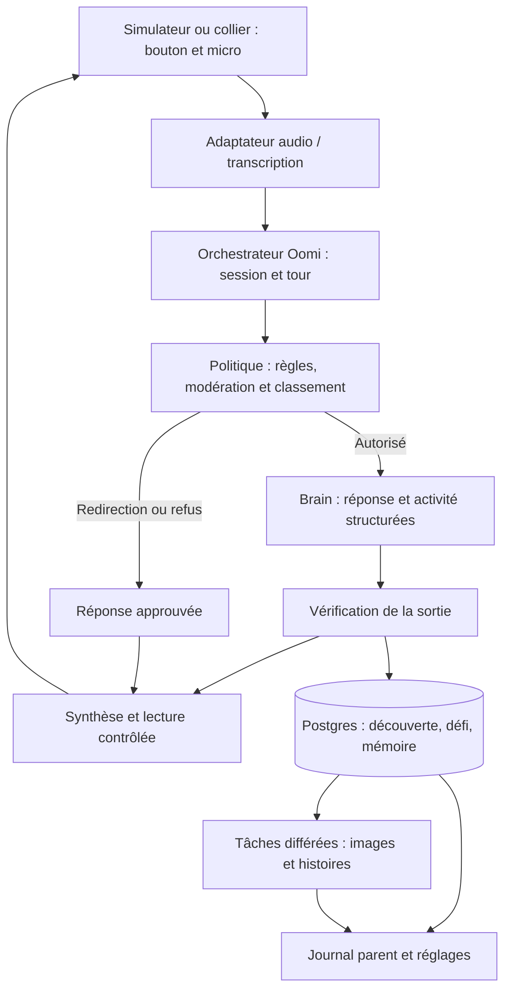

# Oomi — revue du projet et préparation de l’architecture

Revue du 24 octobre 2026. Dépôt examiné : branche `main`, commit `fe50801`. Cette note distingue les intentions de la spec, les capacités documentées des fournisseurs et les propositions à valider par un prototype. Aucun appel payant de génération, déploiement ou test matériel n’a été réalisé.

## 1. Compréhension du produit

Oomi accompagne les enfants de 6 à 10 ans dans une boucle : **question → explication courte → expérience réelle → retour de l’enfant → échange avec le parent**. La mémoire donne une continuité aux découvertes ; l’histoire du soir réutilise ce qui a été appris. Le succès du produit se mesure à ce que l’enfant fait ensuite dans le monde réel.

L’expérience des avions en papier est le scénario de référence à conserver de bout en bout. La voix, le défi enregistré, sa réalisation, la carte parent et l’histoire doivent tous raconter la même découverte.

La répartition donnée dans la conversation prévaut sur les responsabilités encore non attribuées dans la spec : le hardware et le Build in Public ont déjà leurs responsables. Notre chantier est le logiciel, l’architecture et le contrat d’intégration avec le matériel. Les noms et rôles actuels, dont Tim évoqué dans la conversation, ne sont pas entièrement documentés dans ce checkout.

## 2. Ce qui existe, document par document

| Élément examiné | Contenu et conséquence |
|---|---|
| `README.md` | Présentation générale et équipe ; installation et structure encore à définir. |
| `doc/SPEC.md`, §1–3 | Positionnement, utilisateurs et scénario avions. C’est la base produit. |
| §4 | Onze exigences MVP, avec voix, sécurité, mémoire, histoires, journal, réglages et simulateur. Ensemble ambitieux pour la deadline du 25 octobre au soir. |
| §5 | Une interface enfant vocale, huit états visuels, dashboard mobile. Les états doivent suivre les événements réels. |
| §6 | Trois verdicts, contrôle serveur, filtrage entrée/sortie, démo jouée par des adultes et premier jeu de tests. La garantie de contrôle avant lecture reste à construire. |
| §7 | Stack envisagée, outils, mémoire et données. Plusieurs mécanismes GPT-Live et Realtime sont mélangés ; les détails d’exécution sont à préciser. |
| §8 | Produit physique et simulateur. Aucun firmware, schéma électronique ou modèle 3D source n’est présent ici ; cela ne préjuge pas du travail du responsable hardware hors dépôt. |
| §9–10 | Démo de trois minutes et pitch. Ils donnent un ordre de construction utile. |
| §11–12 | Planning, workstreams et risques. Les jalons sont des objectifs, pas des preuves de fonctionnalités réalisées. |
| Annexe A | Résumé de l’inspiration WonderBox : verdicts, journal et confidentialité. Pas de lien vers le reel permettant d’en vérifier indépendamment le contenu. |
| `doc/build-in-public/01-kickoff.md` | Brouillons LinkedIn et X, sondage et calendrier éditorial. Aucun lien de publication ni retour de parents dans le dépôt. Les affirmations de portée LinkedIn et « 1 000 questions/jour » n’y sont pas sourcées. |
| `01-oomi-sketchbook.png` | Exploration du pendentif, bouton, LED, cordon et composants. Concept visuel, pas plan de fabrication validé. |
| `02-oomi-product-render.png` | Direction visuelle : coque corail, bouton vert sauge, visage bleu nuit, formes douces. |
| `03-oomi-paper-plane-story.png` | Illustration de l’expérience réelle des avions, cohérente avec la démo. |
| `04-oomi-expressions.png` | Référence pour les huit expressions. Les animations restent à implémenter. |
| `.env.example`, `.gitignore` | Une variable `OPENAI_API_KEY`, exclusions des secrets et artefacts de développement. |

**État du logiciel :** aucun `package.json`, application, serveur, schéma SQL, migration, prompt exécutable, test ou configuration de déploiement dans le checkout. Les quatre commits portent sur l’initialisation, la documentation et les visuels. Aucun test applicatif ne peut donc être lancé à ce stade.

## 3. Documentation OpenAI actuelle et impact pour Oomi

La veille porte sur les capacités utiles au produit, vérifiées dans les pages officielles le 24 octobre 2026.

| Besoin | Capacité vérifiée | Proposition pour Oomi |
|---|---|---|
| Conversation naturelle | `gpt-live-1` gère la voix en duplex et délègue les tâches à un backend. | Option à évaluer si la fluidité conversationnelle justifie le travail supplémentaire de contrôle audio. [GPT-Live](https://developers.openai.com/api/docs/guides/live) |
| Tours vocaux contrôlés | Realtime documente le push-to-talk avec `turn_detection: null`, validation du tampon et déclenchement explicite de réponse. | Meilleur point de départ pour reproduire le bouton décrit par la spec. [Realtime conversations](https://developers.openai.com/api/docs/guides/realtime-conversations) |
| Transcription | `gpt-live-transcribe` est recommandé pour le flux live ; `gpt-transcribe` pour les enregistrements terminés. | Streaming pendant l’appui, ou requête audio bornée pour une première version simple. [Transcription](https://developers.openai.com/api/docs/guides/transcription) |
| Classement rapide | Decisions accepte un choix parmi des valeurs définies, avec `gpt-6-luna`. | Candidat pour `answer / grown_up / decline`, évalué sur notre propre corpus. [Decisions](https://developers.openai.com/api/docs/guides/decisions) |
| Réponse, activité et mémoire | Responses avec Structured Outputs fournit un objet conforme au schéma ; les refus demandent un traitement distinct. | Une sortie structurée commune, validée côté serveur. [Structured Outputs](https://developers.openai.com/api/docs/guides/structured-outputs) |
| Modèle du Brain | Le catalogue propose GPT-6 Astra, GPT-6.1 Sol et GPT-6 Luna avec différents compromis. | Comparer `gpt-6.1-sol` pour la qualité pédagogique et Luna pour les tâches étroites ; décision après évaluation. [Catalogue](https://developers.openai.com/api/docs/models) |
| Modération | `omni-moderation-latest` traite texte et images, pas l’audio. Des scores entrée/sortie peuvent aussi accompagner Responses. | Modérer la transcription et le contenu produit ; ajouter notre politique d’âge. [Moderation](https://developers.openai.com/api/docs/guides/moderation) |
| Illustrations | GPT Image 2.5 propose Flare pour la génération courante rapide et Sunburst pour la précision d’édition. | Tester `gpt-image-2.5-flare` en tâche différée. [Image generation](https://developers.openai.com/api/docs/guides/image-generation) |

Les évolutions récentes pertinentes sont la disponibilité générale de Decisions le 22 octobre, son intégration à Live le 15 octobre et les voix créées par description le 16 octobre. Ce sont des possibilités supplémentaires, pas des dépendances nécessaires au MVP. [Changelog OpenAI](https://developers.openai.com/api/docs/changelog)

Le guide des voix précise que les voix créées par description sont utilisables avec GPT-Live uniquement. Ne pas les choisir en supposant qu’elles fonctionneront également avec Realtime ou l’API Speech. [Custom voices](https://developers.openai.com/api/docs/guides/custom-voices)

Les anciens modèles TTS, dont `gpt-4o-mini-tts`, sont dépréciés avec arrêt annoncé le 6 janvier 2027. Le remplacement recommandé, `gpt-realtime-2.1-mini`, utilise Realtime et ne se substitue pas directement dans `/v1/audio/speech`. Un ancien TTS reste une option temporaire explicite pour le hackathon, avec migration prévue. [Text to speech](https://developers.openai.com/api/docs/guides/text-to-speech)

L’Assistants API a fermé le 26 août 2026. Le Brain doit partir sur Responses. Ni ChatKit, ni l’Agents API hébergée, ni une orchestration multi-agent ne sont nécessaires pour les six opérations métier décrites dans la spec. Ce dernier point est une recommandation de simplicité pour Oomi. [Deprecations](https://developers.openai.com/api/docs/deprecations)

## 4. Les corrections d’architecture importantes

### GPT-Live et Realtime doivent avoir des adaptateurs distincts

Le mécanisme « relâcher → commit → contrôle → `response.create` » est celui de Realtime. GPT-Live choisit quand parler ; sa documentation demande de retirer les commits audio et déclencheurs manuels de tours vocaux lors d’une migration. Son `response.create` concerne le travail délégué au backend. Changer seulement le nom du modèle casserait donc le fonctionnement décrit. [Migration vers GPT-Live](https://developers.openai.com/api/docs/guides/live-migration)

### Surveiller la sortie ne suffit pas à la valider avant écoute

La modération d’une transcription reçue pendant que l’audio joue peut intervenir trop tard. OpenAI précise qu’un sideband ne contrôle pas à lui seul la lecture : il faut mettre l’audio en tampon dans le lecteur ou un relais, puis libérer les segments approuvés. Cette attente ajoute de la latence. [Server-side controls](https://developers.openai.com/api/docs/guides/voice-server-controls)

Conséquence : choisir explicitement entre validation du texte avant synthèse, ou validation de l’audio généré avant lecture. Un refus dont le libellé doit être fixe peut utiliser un clip approuvé, local au client. Une instruction demandant au modèle de répéter une phrase ne constitue pas à elle seule une garantie de restitution exacte.

### Une seule activité doit alimenter tous les écrans

Le §7.2 fait parler le modèle vocal pendant qu’un autre modèle prépare l’activité. Ils pourraient proposer deux expériences différentes. Je recommande un objet serveur commun contenant au minimum le texte bref à prononcer, le sujet, l’activité, son identifiant et les faits éducatifs à conserver. Les illustrations et les enrichissements du journal peuvent arriver ensuite. Le défi lui-même doit être connu avant d’être proposé oralement.

### Le budget de latence reste à mesurer

Les 300–500 ms de sécurité et les 1,5 s jusqu’à la parole sont des objectifs de la spec. Aucun benchmark du projet ne les confirme. Mesurer séparément la fin de transcription, les vérifications, la génération du texte, la première donnée audio et le début de lecture approuvée. Suivre médiane et p95 sur le matériel et le réseau de démo. Ne pas compter un son d’attente comme une réponse éducative.

### Le push-to-talk porte sur le micro, pas uniquement sur les réponses

Désactiver la détection de fin de parole ne coupe pas la capture. Il faut bloquer réellement la capture ou l’envoi hors appui, gérer la perte de focus et les événements d’annulation du bouton, et couper la lecture dès un nouvel appui. Les yeux `speaking` suivent le lecteur audio, pas seulement la réception d’un événement réseau.

## 5. Architecture proposée pour commencer

Conserver Next.js, TypeScript, Zod et Postgres comme socle prévu. Isoler les règles Oomi du transport vocal : le matériel et le simulateur doivent réutiliser les mêmes opérations et événements métier, même si leurs codecs et connexions diffèrent.

Ce schéma décrit les responsabilités, pas une obligation de faire transiter tous les octets audio dans une route HTTP Next.js.

**Point de départ recommandé :** un prototype vocal sur une seule question, avec transcription, verdict serveur, réponse structurée et lecture contrôlée. Comparer le chemin texte validé puis synthèse avec Realtime à tours manuels. Si la voix reste générative après validation du texte, vérifier aussi sa fidélité ou retenir l’audio jusqu’au contrôle. Choisir ensuite le chemin principal sur des mesures, avant de construire toutes les pages.

Les quatre blocs logiciels peuvent rester dans un seul dépôt : interface, logique métier serveur, adaptateurs OpenAI/audio et tâches différées. Un deuxième service de session n’est utile que si le cycle de vie de l’hébergement l’exige.

### Hébergement

La documentation Vercel consultée annonce désormais le support natif des WebSockets sur Functions avec Fluid Compute, décrit en bêta publique dans sa page dédiée. Les connexions restent limitées par la durée de la fonction et une reconnexion peut atteindre une autre instance. Il faut donc prévoir reprise et état partagé ; conserver une socket dans une variable globale n’est pas une stratégie de session suffisante. [WebSockets sur Vercel](https://vercel.com/kb/guide/do-vercel-serverless-functions-support-websocket-connections)

Les limites documentées sont 300 s sur Hobby, 800 s sur Pro/Enterprise, avec extension bêta jusqu’à 1 800 s sur certains runtimes. Le plan du projet reste inconnu. Une session longue doit pouvoir se reconnecter ou être portée par un service adapté. [Durées des Functions](https://vercel.com/docs/functions/configuring-functions/duration)

Les illustrations demandent un stockage de fichiers et des travaux reprenables : état `pending / ready / failed`, nombre de tentatives et clé d’idempotence. Un traitement démarré sans être suivi après une réponse HTTP ne suffit pas à garantir leur réalisation. Le journal doit fonctionner même si une image échoue.

## 6. Contrats et données à préciser

| Contrat | Éléments nécessaires |
|---|---|
| Autorisation | Parent propriétaire, appareil associé, accès vérifié à chaque donnée et session. Le `childId` envoyé par un client ne suffit pas. |
| Session | Identifiant, appareil, horaires avec fuseau, durée maximale, langue, fermeture et reprise. |
| Tour | `turnId`, ordre des événements, verdict, statut, annulation, temps mesurés et déduplication. |
| Réponse | Texte bref, type d’intention, activité et référence du défi, résultat du contrôle de sortie. |
| Mémoire | Faits éducatifs autorisés, provenance, suppression et version pour rejeter les résultats de travaux devenus obsolètes. |
| Histoire | Découvertes sources, texte approuvé, images en cours, fin de lecture puis veille. |
| Matériel | Transport disponible, format audio, fréquence, taille des messages, bouton, annulation, reconnexion et événements d’expression. |

Compléter les tables de la spec avec les relations d’appartenance et les métadonnées de session/tour/travail nécessaires. Cela ne demande pas de conserver les conversations intégrales. Pour les questions sensibles, définir précisément ce qui devient visible au parent et ce qui est supprimé ou reformulé.

Enregistrer les faits approuvés au fil des tours ; une consolidation uniquement à la fermeture de session peut être perdue si le navigateur ou le réseau tombe. La suppression parent doit invalider aussi les traitements en attente et retirer le contexte concerné de la session active.

Pour le matériel, partager les états et paramètres visuels ; ne pas présumer que le code SVG/CSS du navigateur sera directement réutilisable dans le firmware. Le SDK embarqué évoqué au §8.3 n’a ni lien ni version dans la spec et n’a pas été confirmé par la recherche sur les domaines de documentation OpenAI consultés. Son existence précise et sa compatibilité avec la carte choisie restent à vérifier avec le responsable hardware.

## 7. Sécurité, mémoire et promesses produit

Le classement Oomi est plus spécifique que la modération générale. Une question sur le deuil peut relever de `grown_up` sans être signalée par Moderation. Inversement, un mot comme « feu » peut apparaître dans une question éducative légitime. Il faut évaluer le contexte, la formulation et l’activité proposée.

Prévoir une intention distincte du verdict : question éducative, résultat de défi, demande d’histoire ou échange social. Cela évite d’imposer un nouveau défi quand l’enfant vient simplement raconter le résultat du précédent. Une urgence ou une situation de détresse demande également un traitement explicite ; la formule enthousiaste « excellente question » n’est pas adaptée à tous les renvois vers un adulte.

La suite existante donne un premier test de non-régression. Ajouter variantes françaises et anglaises, négations, tentatives de contournement, silence, bruit, coupures réseau, vérification indisponible, résultat tardif après annulation et effacement pendant un traitement. Un résultat de 100 % signifie uniquement que ce corpus passe.

La règle de la spec réservant la démo à des adultes est cohérente avec la documentation OpenAI : le traitement des données personnelles des moins de 13 ans, ou de l’âge de consentement numérique applicable, exige préalablement Zero Data Retention. [Under-18 guidance](https://developers.openai.com/api/docs/guides/safety-checks/under-18-api-guidance)

Ne pas confondre absence d’enregistrement dans notre base et absence de rétention chez le fournisseur. ZDR nécessite une approbation et `store: false` ne le remplace pas. Vérifier aussi logs, traces, stockage de session et services tiers. Le texte public « No audio stored. Ever. » doit correspondre à la configuration réellement retenue. [Data controls](https://developers.openai.com/api/docs/guides/your-data)

## 8. Ordre de construction proposé

1. **Prouver la voix contrôlée.** Bouton, transcription, les trois verdicts, lecture, interruption, repli et mesures de latence ; essais par des adultes avec profil fictif.
2. **Relier l’histoire des avions.** Même activité dans la réponse et le journal ; défi persistant, retour « les grandes ailes ont gagné », mémoire réutilisée à la session suivante.
3. **Appliquer les contrôles parent.** Accès, horaires, durée, visualisation et suppression de mémoire réellement appliqués au serveur.
4. **Ajouter l’histoire et les images.** Génération reprenable, écran utilisable pendant l’attente, récit fini puis veille.
5. **Intégrer le matériel et répéter.** Réutiliser le contrat convenu, tester la déconnexion et enregistrer la démo de secours.

Cet ordre conserve les fonctionnalités demandées tout en plaçant les inconnues techniques avant le travail de présentation. Les rendus et la communication peuvent avancer avec leurs responsables.

Les premières informations d’intégration à récupérer sont la carte et le firmware déjà choisis, le protocole/codec disponible, le compte et le plan d’hébergement, l’accès effectif aux modèles et la langue de démo. Elles ne bloquent pas la définition des schémas et du scénario de validation.

À titre de repère, GPT-Live est documenté à 0,05 $ par minute de session, hors backend et outils : une session de dix minutes représente 0,50 $ de voix seule. Les coûts réels du projet dépendront aussi des images, modèles, durées et reprises ; aucun budget n’a été mesuré ici. [Tarification GPT-Live](https://developers.openai.com/api/docs/models/gpt-live-1)

**Prochain livrable concret :** un tour vocal complet et mesuré sur le simulateur, avec aucun audio non approuvé joué, puis la carte parent issue du même objet métier. Ce résultat permettra de fixer l’architecture vocale et de répartir l’implémentation sans dépendre de suppositions sur les API.
